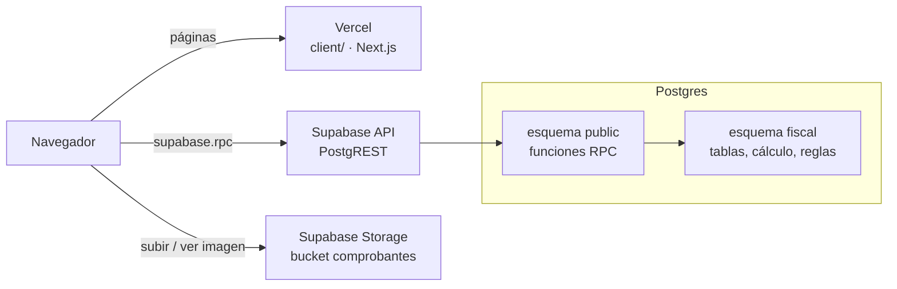
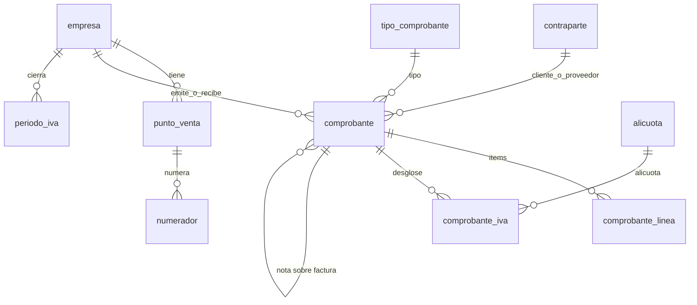
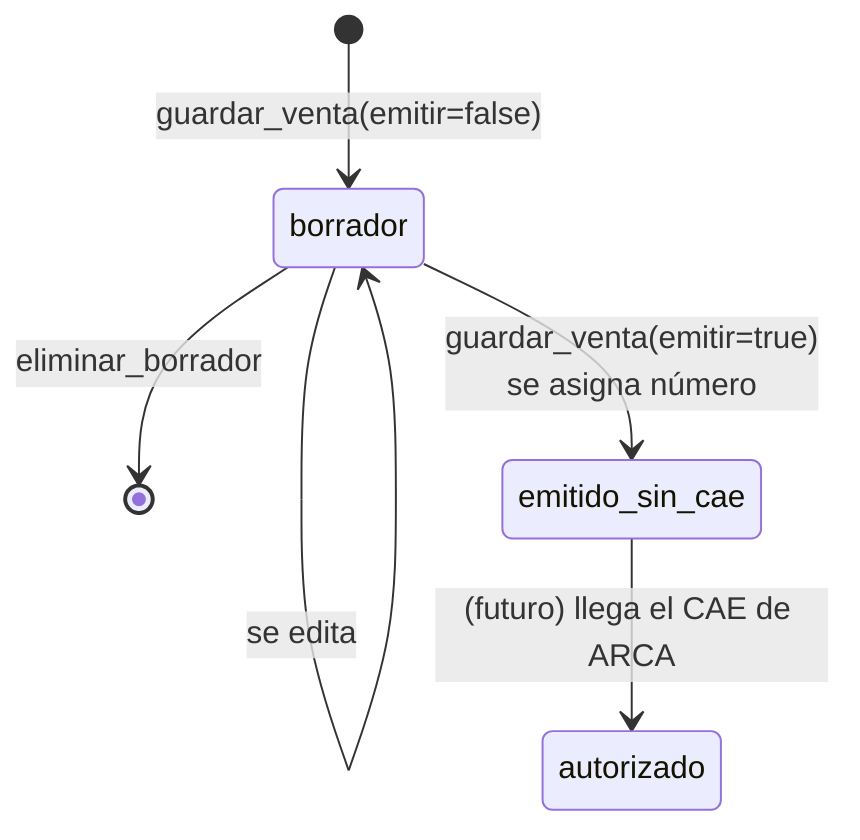
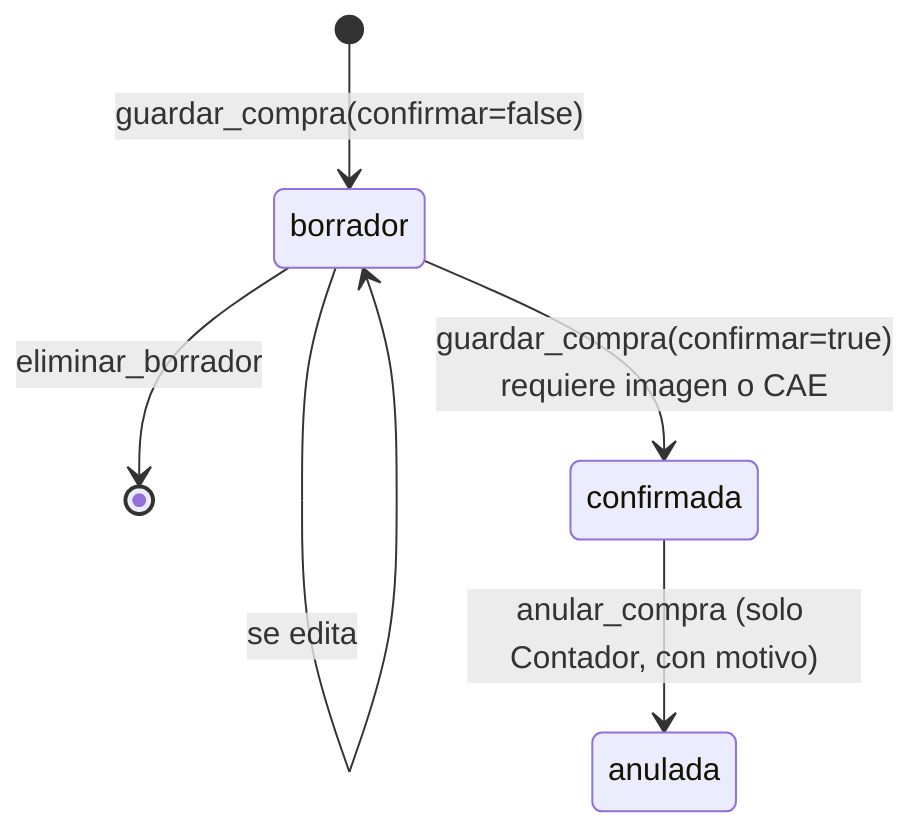
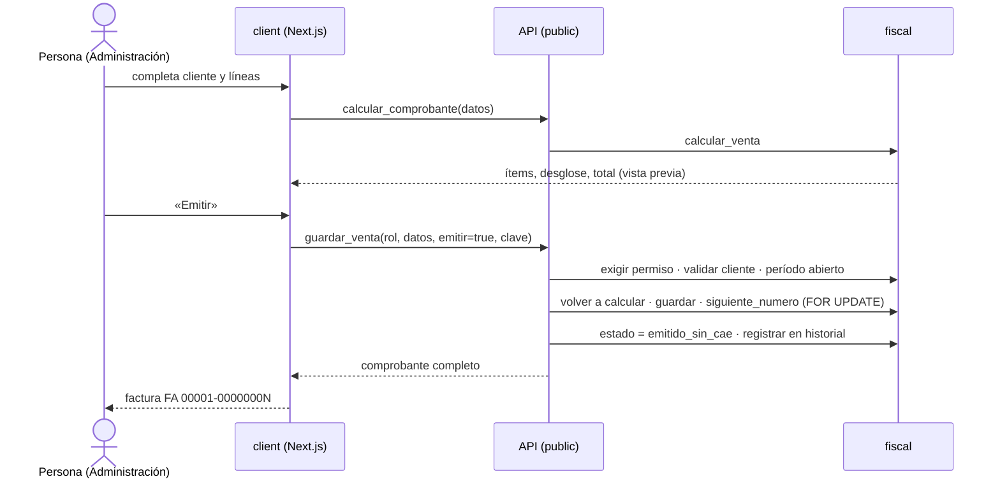

# Motores Pesados · Prototipo 1.0

Módulo de facturación e IVA para el CRM de Motores Pesados. Cubre dos empresas: **MP** (Mecánica Pesada) y **RMP** (Rectificaciones Motores Pesados). Permite:

- emitir facturas de venta y sus notas de crédito y débito;
- cargar las facturas de compra que mandan los proveedores, con su imagen;
- ver los **dos libros de IVA** (ventas y compras), la **posición de IVA** del mes y **cerrar el período**;
- exportar todo a Excel.

## Índice

1. [Cómo está armado](#1-cómo-está-armado)
2. [Estructura del repo](#2-estructura-del-repo)
3. [Server: la base de datos](#3-server-la-base-de-datos)
4. [Cómo se calcula una factura](#4-cómo-se-calcula-una-factura)
5. [Ciclo de vida de los comprobantes](#5-ciclo-de-vida-de-los-comprobantes)
6. [Reglas que hace cumplir la base](#6-reglas-que-hace-cumplir-la-base)
7. [La API (funciones RPC)](#7-la-api-funciones-rpc)
8. [Roles y permisos](#8-roles-y-permisos)
9. [Client: la app Next.js](#9-client-la-app-nextjs)
10. [Recorrido de una factura de punta a punta](#10-recorrido-de-una-factura-de-punta-a-punta)
11. [Puesta en marcha](#11-puesta-en-marcha)
12. [Pruebas](#12-pruebas)
13. [Fuera de esta versión](#13-fuera-de-esta-versión)
14. [Glosario](#14-glosario)

---

## 1. Cómo está armado



Hay dos partes, cada una en su carpeta:

| Parte | Dónde corre | Qué hace |
|---|---|---|
| **`client/`** | Vercel | Pantallas en Next.js. Muestra datos y manda lo que la persona escribe. **No calcula nada que se guarde.** |
| **`server/`** | Supabase | Migraciones SQL: tablas, cálculo fiscal, reglas y la API. Toda la lógica de negocio vive acá. |

La decisión de fondo es que **la lógica está en la base**, no en el front:

- El IVA, los totales, la letra de la factura, el número y los permisos los resuelve Postgres dentro de funciones.
- Si mañana se cambia el front (por ejemplo, para integrarlo al CRM real), las reglas siguen valiendo, porque nadie puede saltearlas desde el navegador.
- El front llama a la base con `supabase.rpc('nombre_funcion', {...})` y Supabase traduce esa llamada en un `select nombre_funcion(...)`.

### Por qué dos esquemas

- **`fiscal`** guarda las tablas y las funciones internas. Supabase **no lo expone** por la API, así que desde el navegador no se puede leer ni escribir ninguna tabla directamente.
- **`public`** tiene solo las funciones de la API. Son `SECURITY DEFINER`: corren con permisos del dueño de la base, validan rol y reglas, y recién ahí tocan `fiscal`.

Así, la única puerta de entrada a los datos son las funciones, y cada una controla lo que deja hacer.

---

## 2. Estructura del repo

```
client/                         App Next.js (lo que ve la persona)
  app/                          Una carpeta por pantalla (App Router)
    libro/                      Libros de IVA de ventas y compras + posición
    ventas/  ventas/nueva/  ventas/[id]/
    compras/ compras/nueva/ compras/[id]/
    clientes/  proveedores/
    cierre/                     Cierre de período + historial
    layout.tsx  page.tsx  globals.css
  components/                   Shell (menú, rol, tema), ui, Papel (factura impresa), Contrapartes
  lib/
    supabase.ts                 Cliente de Supabase (URL + anon key)
    api.ts                      Tipos y una función por RPC
    contexto.tsx                Estado global: empresa, rol, catálogos, avisos
    formato.ts                  Pesos, fechas, montos en letras
    exportar.ts                 Excel con exceljs
  .env.example

server/
  supabase/
    config.toml
    migrations/
      20261022000001_esquema_fiscal.sql      Tablas
      20261022000002_reglas_y_calculo.sql    Catálogos, cálculo, triggers, ayudas
      20261022000003_api.sql                 Funciones RPC + permisos
      20261022000004_storage.sql             Bucket de imágenes
      20261022000005_datos_base.sql          Las dos empresas (ficticias)
      20261022000006_datos_ejemplo.sql       Facturas de ejemplo del Simulador
  tests/
    correr.sh                   Crea una base temporal, migra y prueba
    stub_supabase.sql           Imita lo mínimo de Supabase en un Postgres común
    pruebas.sql                 73 pruebas
```

---

## 3. Server: la base de datos

### Tablas (esquema `fiscal`)



| Tabla | Para qué |
|---|---|
| `condicion_iva`, `tipo_comprobante`, `alicuota`, `tipo_documento` | Catálogos con los códigos de ARCA. `condicion_iva.letra_venta` dice qué letra le corresponde a cada cliente. `tipo_comprobante.signo` vale −1 en las notas de crédito para que resten en el libro. |
| `rol`, `permiso` | Los 5 roles y qué acción puede hacer cada uno. |
| `empresa` | MP y RMP, con CUIT, domicilio y leyenda de la factura. |
| `punto_venta` | Puntos de venta de cada empresa. |
| `numerador` | Último número usado por empresa, punto de venta y tipo. Garantiza numeración sin huecos. |
| `contraparte` | **Clientes y proveedores en una sola tabla** (`es_cliente` / `es_proveedor`), con sus datos fiscales. |
| `comprobante` | **Ventas y compras en la misma tabla** (`operacion` = `venta` o `compra`). Tiene la cabecera, los importes y una *foto* de los datos del cliente o proveedor al momento de emitir, para que la factura no cambie si después se edita el cliente. |
| `comprobante_linea` | Ítems de una venta: cantidad, precio, descuento, alícuota e importe. |
| `comprobante_iva` | Desglose por alícuota (base e IVA). Es lo que leen los libros. |
| `periodo_iva` | Meses cerrados por empresa. |
| `historial` | Registro de todo lo que se hizo. Solo altas. |
| `idempotencia` | Respuestas guardadas para que un reintento no emita dos veces. |

**Importes:** siempre `numeric(14,2)`, nunca `float`. Así no hay errores de redondeo de centavos. Hay un `check` (`total_cierra`) que obliga a que el total sea exactamente la suma de sus partes.

### Qué hay en cada migración

1. **`…01_esquema_fiscal.sql`**: crea el esquema `fiscal`, todas las tablas, los índices únicos (no repetir número de venta, no cargar dos veces la misma compra) y le quita el acceso a todo el mundo.
2. **`…02_reglas_y_calculo.sql`**: carga los catálogos y los permisos. Define:
   - las funciones de cálculo (`calcular_venta`, `calcular_compra`, `desglosar`, `calcular_iva`);
   - las validaciones (`cuit_valido` con dígito verificador, `documento_valido`);
   - los **triggers de inmutabilidad**;
   - las ayudas que usa la API: `exigir` (permisos), `registrar` (historial), `siguiente_numero`, `exigir_periodo_abierto` e idempotencia.
3. **`…03_api.sql`**: las funciones públicas que llama el front (ver [sección 7](#7-la-api-funciones-rpc)) y los `grant` para que el rol `anon` las pueda ejecutar.
4. **`…04_storage.sql`**: bucket privado `comprobantes`. Acepta PNG, JPG, WEBP y PDF de hasta 10 MB. Se puede subir y ver, pero no reemplazar ni borrar.
5. **`…05_datos_base.sql`**: las dos empresas con CUIT de prueba.
6. **`…06_datos_ejemplo.sql`**: clientes, proveedores y las facturas del Simulador. Se cargan llamando a las mismas funciones que usa el front, así que también prueban las reglas.

### Errores de negocio

Cuando una regla no se cumple, la función corta con `fiscal.error(codigo, detalle, campo)`:

- **`message`** lleva el código, por ejemplo `PERIODO_CERRADO`.
- **`detail`** lleva el texto para la persona, por ejemplo "El período 2026-10 está cerrado…".
- **`hint`** lleva el campo del formulario que hay que marcar.
- El SQLSTATE es `PT409`, `PT422`, `PT403` o `PT404`. PostgREST lo devuelve como ese código HTTP.

En el client, `lib/api.ts` convierte eso en un `ErrorNegocio` y la pantalla muestra el detalle junto al campo.

---

## 4. Cómo se calcula una factura

El cálculo existe **una sola vez**, en `fiscal.calcular_venta` y `fiscal.calcular_compra`. Mientras la persona carga, el client pide una **vista previa** con `calcular_comprobante`, que no guarda nada. Al guardar, el server **vuelve a calcular** con los mismos datos. El front nunca manda totales.

**Venta (por línea):**
```
precio unitario = redondear(precio lista × (100 − descuento) ÷ 100, 4 decimales)
importe neto    = redondear(cantidad × precio unitario, 2 decimales)
```

**IVA:** se agrupa por alícuota y se calcula **sobre la suma de los netos**, no línea por línea:
```
IVA de la alícuota = redondear(suma de netos × % ÷ 100, 2)
```
El redondeo es *mitad hacia arriba*: `round()` de Postgres sobre `numeric`.

**Precio final (Factura B de mostrador):** se carga el total con IVA incluido. El neto se obtiene como `redondear(total × 100 ÷ (100 + %), 2)` y el IVA es la diferencia, así el total impreso es exactamente el que se cobró.

**Total:**
```
total = neto gravado + no gravado + exento + IVA + otros tributos + percepción IVA + percepción IIBB
```

**Compra:** se copia lo que dice el papel del proveedor: base por alícuota, no gravado, exento y percepciones. Si es una Factura **B o C**, no se discrimina IVA: el sistema rechaza que se cargue IVA, porque no da crédito fiscal.

**Libros y posición:**
- Cada fila del libro sale de `comprobante_iva` repartido en columnas por alícuota (21 %, 10,5 %, 27 %, otras, 0 %), con el signo del tipo: **las notas de crédito restan**.
- Entran al libro las ventas emitidas o autorizadas y las compras confirmadas. Los borradores y las anuladas quedan afuera.
- **Posición = débito fiscal (IVA de ventas) − crédito fiscal (IVA de compras).** Las percepciones se muestran aparte, solo como información.

---

## 5. Ciclo de vida de los comprobantes

**Ventas**


**Compras**


- Una venta emitida **no se edita ni se borra**: se corrige con una **nota de crédito o débito** asociada (`emitir_nota_venta`). Las notas de crédito no pueden superar el total que queda disponible de la factura.
- Una compra confirmada no se edita. Si estaba mal, se **anula con motivo** y se carga de nuevo.

---

## 6. Reglas que hace cumplir la base

Estas reglas no dependen del front: aunque alguien llame a la API a mano, se cumplen igual.

| # | Regla | Dónde se aplica |
|---|---|---|
| 1 | Todo comprobante tiene empresa; MP y RMP nunca se mezclan en un libro. | Columna obligatoria + filtros de `libro_filas` |
| 2 | Lo emitido o confirmado **no se edita ni se borra**. Solo se permiten dos pasos: confirmada → anulada y emitida → autorizada. | Trigger `t_inmutable` en `comprobante`, `comprobante_linea` y `comprobante_iva` |
| 3 | La numeración de ventas la pone la base al emitir, **sin huecos**. | `siguiente_numero` con `SELECT … FOR UPDATE` sobre `numerador` |
| 4 | La letra sale de la condición de IVA del cliente: A para responsables inscriptos y monotributistas, B para consumidor final y exentos. | `guardar_venta` lee `condicion_iva.letra_venta` |
| 5 | Una compra no se carga dos veces, y para confirmarla hace falta imagen o CAE. | Índice único `uq_compra_numero` + validación en `guardar_compra` |
| 6 | Un período cerrado bloquea emitir, cargar y anular con fecha de ese mes. | `exigir_periodo_abierto` |
| 7 | Todo queda en el historial, y el historial es solo de altas. | `registrar` + trigger en `historial` |
| 8 | Cada acción la puede hacer solo el rol que corresponde. | `exigir(rol, accion)` contra la tabla `permiso` |

Además:
- Se valida el CUIT con su dígito verificador.
- Una Factura B a consumidor final desde $ 10.000.000 exige identificar al cliente (RG 5866).
- Emitir y confirmar usan **idempotencia**: el client manda una clave única, y si la misma llamada llega dos veces (doble clic o reintento de red) se devuelve el mismo resultado sin emitir otra factura.

---

## 7. La API (funciones RPC)

Todas están en `public` y se llaman con `supabase.rpc(nombre, parámetros)`. Las que escriben reciben `p_rol`, porque en esta versión no hay login.

**Lecturas**

| Función | Devuelve |
|---|---|
| `catalogos()` | Empresas, puntos de venta, tipos, condiciones, alícuotas, roles y permisos |
| `listar_contrapartes(p_tipo)` | Clientes o proveedores, con qué dato fiscal les falta |
| `listar_comprobantes(p_empresa, p_operacion, p_periodo)` | Lista de ventas o de compras |
| `obtener_comprobante(p_id)` | Un comprobante completo: ítems, desglose, notas asociadas y saldo para notas de crédito |
| `calcular_comprobante(p_datos)` | Vista previa de importes, sin guardar |
| `libro_iva(p_empresa, p_periodo, p_operacion)` | Filas y totales del libro de ventas o de compras |
| `posicion_iva(p_empresa, p_periodo)` | Débito, crédito, saldo y percepciones |
| `periodos_iva(p_empresa)` | Meses con movimiento y su posición |
| `pendientes_cierre(p_empresa, p_periodo)` | Lo que hay que revisar antes de cerrar |
| `exportar_facturas(p_empresa, p_periodo)` | Filas con las columnas de la hoja «Facturas» del Excel |
| `ver_historial(p_rol, p_empresa)` | Historial de cambios |

**Escrituras**

| Función | Hace |
|---|---|
| `guardar_contraparte(p_rol, p_datos)` | Alta o edición de un cliente o proveedor |
| `guardar_venta(p_rol, p_datos, p_emitir, p_clave)` | Guarda el borrador y, si `p_emitir`, lo emite con número |
| `emitir_nota_venta(p_rol, p_datos, p_clave)` | Nota de crédito o débito sobre una factura emitida |
| `guardar_compra(p_rol, p_datos, p_confirmar, p_clave)` | Guarda y, si `p_confirmar`, confirma una compra |
| `anular_compra(p_rol, p_id, p_motivo)` | Anula una compra confirmada |
| `eliminar_borrador(p_rol, p_id)` | Borra un borrador (lo único que se puede borrar) |
| `cerrar_periodo(p_rol, p_empresa, p_periodo)` | Cierra el mes |

Ejemplo de llamada desde el client (`lib/api.ts`):
```ts
const factura = await api.guardarVenta('administracion', {
  empresa_id: 'MP', punto_venta: 1, contraparte_id: '…', fecha: '2026-10-22',
  lineas: [{ descripcion: 'Rectificación', cantidad: '1', precio: '100000', alicuota_codigo: 5 }],
}, true); // true = emitir
```

---

## 8. Roles y permisos

No hay login todavía: el rol se elige abajo a la izquierda en la app y viaja como parámetro `p_rol`. Los permisos están en la tabla `fiscal.permiso`.

| Acción | Administración | Contador | Gerencia | Adm. técnico | Estudiante |
|---|:-:|:-:|:-:|:-:|:-:|
| Datos fiscales de clientes y proveedores | ✓ | ✓ | | ✓ | |
| Emitir facturas y notas de venta | ✓ | | | | |
| Cargar y confirmar compras | ✓ | ✓ | | | |
| Anular compras | | ✓ | | | |
| Cerrar períodos | | ✓ | | | |
| Ver historial | | ✓ | ✓ | ✓ | ✓ |
| Ver libros, comprobantes y exportar | ✓ | ✓ | ✓ | ✓ | ✓ |

> Como el rol lo elige el navegador, esto **muestra** cómo serían los permisos, pero no es seguridad real. En la versión con login, el rol saldría del token de Supabase Auth y las funciones lo leerían de ahí en lugar de `p_rol`.

---

## 9. Client: la app Next.js

**Tecnologías:** Next.js 16 (App Router), React 19, TypeScript, `@supabase/supabase-js` y `exceljs`. Sin librerías de UI: el CSS es el del Simulador (`app/globals.css`), con modo claro y oscuro.

**Pantallas**

| Ruta | Qué muestra |
|---|---|
| `/libro` | Libros de ventas y de compras del mes con totales por alícuota, posición de IVA y botón de exportar a Excel |
| `/ventas`, `/ventas/nueva`, `/ventas/[id]` | Lista, formulario con cálculo en vivo y detalle con la factura en papel (imprimible) y notas |
| `/compras`, `/compras/nueva`, `/compras/[id]` | Lista, carga con desglose y subida de imagen, detalle con respaldo y anulación |
| `/clientes`, `/proveedores` | Datos fiscales, con aviso de lo que falta para poder facturar |
| `/cierre` | Períodos, controles antes de cerrar e historial |

**Piezas compartidas**

- `lib/supabase.ts` crea el cliente con `NEXT_PUBLIC_SUPABASE_URL` y `NEXT_PUBLIC_SUPABASE_ANON_KEY`. Si faltan, la app muestra un aviso en lugar de romperse.
- `lib/api.ts` tiene los tipos de cada respuesta, una función por RPC y la clase `ErrorNegocio`. También tiene `subirImagen`, que sube al bucket con la ruta `empresa/AAAA-MM/uuid.ext`, y `urlImagen`, que pide un link firmado válido por 10 minutos.
- `lib/contexto.tsx` guarda el estado de la app: empresa, rol, tema, catálogos y avisos. Lo guarda en `localStorage` solo como preferencia. También tiene el hook `useDatos`, que carga y recarga datos.
- `lib/exportar.ts` arma el `.xlsx` con las hojas *Facturas*, *Libro IVA Ventas*, *Libro IVA Compras* y *Posición IVA*, con los números que ya vienen calculados del server.
- `components/Shell.tsx` tiene el menú lateral, el selector de rol y de empresa, el tema y los avisos.
- `components/Papel.tsx` dibuja la factura como sale impresa.

Todas las páginas son componentes de cliente (`'use client'`) que llaman a Supabase desde el navegador. Next.js no tiene rutas de API propias: el "backend" es Supabase.

---

## 10. Recorrido de una factura de punta a punta



Una compra sigue el mismo camino, con dos diferencias:
- antes de confirmar, el client sube la imagen a Storage y manda la ruta en `imagen_path`;
- la base no asigna número: se usa el del proveedor, y se controla que no esté cargado dos veces.

---

## 11. Puesta en marcha

### Supabase

Se necesita un proyecto de Supabase. Las migraciones de `server/supabase/migrations/` se aplican en orden, de una de estas formas:

- **SQL Editor:** pegar cada archivo en orden y ejecutarlo.
- **CLI de Supabase:** `supabase link` y `supabase db push`, desde `server/`.
- **Integración de GitHub:** Project Settings → Integrations → GitHub, con Working directory = `server`.

> El proyecto de la demo (`owvidccindbpbntxayeq`) ya tiene todo aplicado. Se cargó a mano y en partes, así que el historial de migraciones de Supabase no coincide con los nombres de los archivos. **No activar** la integración de GitHub sobre ese proyecto sin antes alinear ese historial, porque intentaría aplicar todo de nuevo.

Las tablas se ven en el Table Editor eligiendo el esquema **`fiscal`**. En `public` no hay tablas, solo funciones.

### Client local

```bash
cd client
cp .env.example .env.local    # completar URL y anon key (Project Settings → API)
npm install
npm run dev                   # http://localhost:3000
npm run typecheck             # chequeo de tipos
```

### Vercel

El proyecto se importa desde este repo con **Root Directory = `client`**. Hacen falta solo dos variables:

| Variable | Valor |
|---|---|
| `NEXT_PUBLIC_SUPABASE_URL` | `https://<ref>.supabase.co` |
| `NEXT_PUBLIC_SUPABASE_ANON_KEY` | La anon key (pública) del proyecto |

Las variables con service role, secret o JWT **no hacen falta**, y conviene no tenerlas en el proyecto de Vercel. Cada push a `main` despliega solo.

---

## 12. Pruebas

```bash
server/tests/correr.sh    # necesita Postgres 15+ local; crea la base temporal mp_pruebas
```

El script hace tres cosas:
1. Crea una base vacía y le aplica `stub_supabase.sql`, que crea los roles `anon` y `authenticated` y un esquema `storage` mínimo, como tiene Supabase.
2. Aplica todas las migraciones.
3. Corre las **73 pruebas** de `pruebas.sql`:
   - cálculo de líneas, IVA por alícuota, precio final y redondeo;
   - libros y posición contra la verdad de referencia del Simulador: octubre 2026 de MP da débito **214.755,37**, crédito **107.100,00** y saldo **107.655,37**;
   - inmutabilidad, numeración, letra, duplicados, períodos cerrados, permisos, historial e idempotencia.

---

## 13. Fuera de esta versión

- **Login real** con Supabase Auth, con el rol dentro del token.
- **CAE de ARCA**: pedido y autorización de facturas electrónicas.
- Integración con el CRM: presupuestos y órdenes de compra.
- Conciliación con «Mis Comprobantes» de ARCA.
- Moneda extranjera en pantalla. La base ya guarda moneda y cotización.
- Libro diario y asientos contables.
- Limitación conocida: en la factura en papel, la Factura B muestra los precios netos en lugar de los precios con IVA incluido.

---

## 14. Glosario

| Término | Significa |
|---|---|
| **ARCA** | La agencia de recaudación (ex AFIP). |
| **CAE** | Código de autorización que da ARCA a cada factura electrónica. |
| **Letra A / B / C** | Tipo de factura. A discrimina IVA (entre responsables inscriptos), B no lo discrimina (consumidor final, exento) y C es la que emite un monotributista. |
| **Alícuota** | Porcentaje de IVA: 21 %, 10,5 %, 27 % o 0 %. |
| **Débito fiscal** | IVA que se cobró en las ventas. |
| **Crédito fiscal** | IVA que se pagó en las compras y se puede descontar. |
| **Posición de IVA** | Débito − crédito: lo que hay que pagar en el mes, o el saldo a favor. |
| **Percepción** | Impuesto que cobra un proveedor por adelantado. Se informa aparte. |
| **Nota de crédito / débito** | Comprobante que corrige una factura, restando o sumando. |
| **Período** | Mes de IVA, `AAAA-MM`. |
| **RPC** | Llamar a una función de la base desde el front como si fuera un endpoint. |
| **SECURITY DEFINER** | La función corre con los permisos de su dueño, no con los de quien la llama. |
